# FDTD, FEM or MoM?

**Live:** https://benjhardy.github.io/em-solver-guide/ · part of [benjhardy.github.io](https://benjhardy.github.io/)

An interactive guide to electromagnetic (EM) solvers. Learn how the three main full-wave methods work, see their meshes on real devices in 3D, and select a solver and a tool for your problem.

The full guide is one HTML file, [`index.html`](index.html). Open it in a browser. It needs no build step and no server.


## What is in the guide

### Devices in 3D
Select one of 20 devices, from an on-chip spiral to a ship. The guide opens on a 28 GHz antenna in package. The 3D view shows the real mesh that each solver uses, made with [Gmsh](https://gmsh.info):
- **FEM:** the conformal tetrahedral mesh, shown as a slice through the middle, with the counts of tetrahedra and edges.
- **FDTD:** a graded Yee grid whose lines snap to the faces of each part.
- **MoM:** the triangles on the metal (top sheets only for 2.5D MoM), with the number of RWG unknowns.

The card shows which solver to use first, and why. A guess mode lets you test yourself before the answer shows.

| FEM tetrahedra, antenna in package | FDTD Yee grid, antenna in package | MoM triangles, antenna in package |
|---|---|---|
| 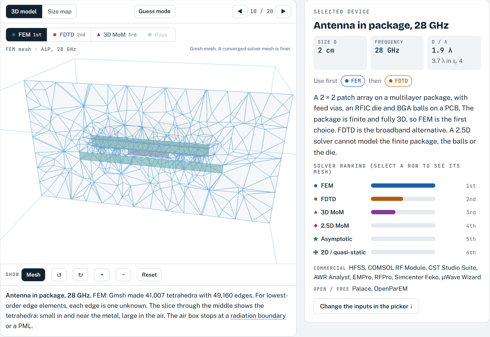 | 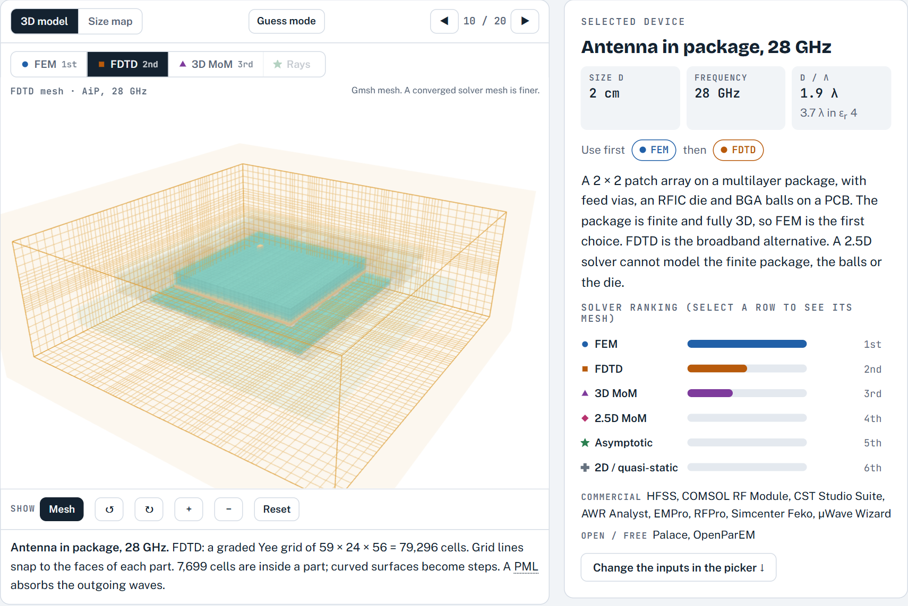 | 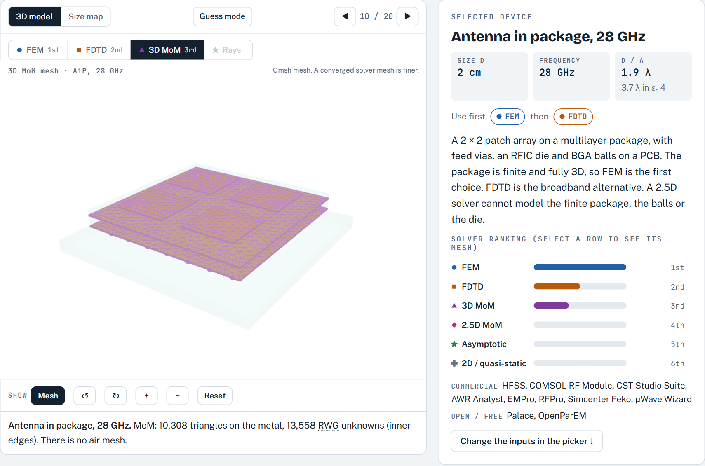 |

### How each solver works
Step-by-step 3D lessons, each with a short quiz:
- **FDTD:** the Yee cell, with E on the edges, H on the faces and leapfrog time steps.
- **FEM:** the tetrahedron, with one unknown on each edge, the sparse matrix and adaptive refinement.
- **MoM:** the RWG basis function, the Green's function and the dense matrix.

| Yee cell | Tetrahedra | RWG pair |
|---|---|---|
| 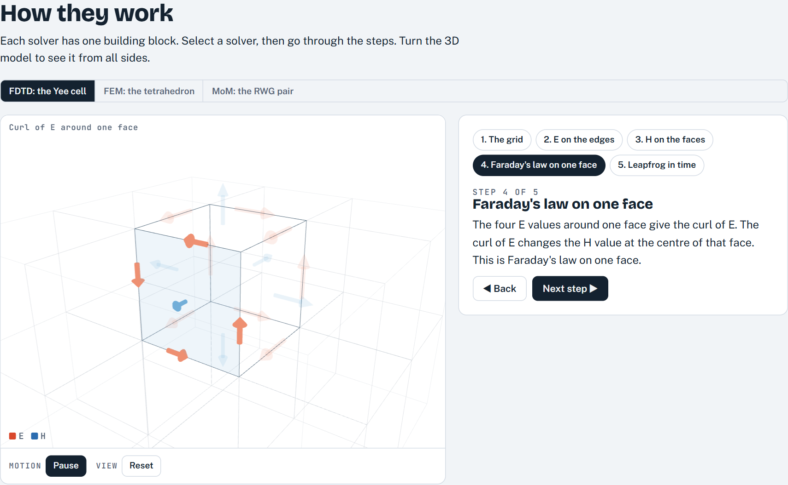 | 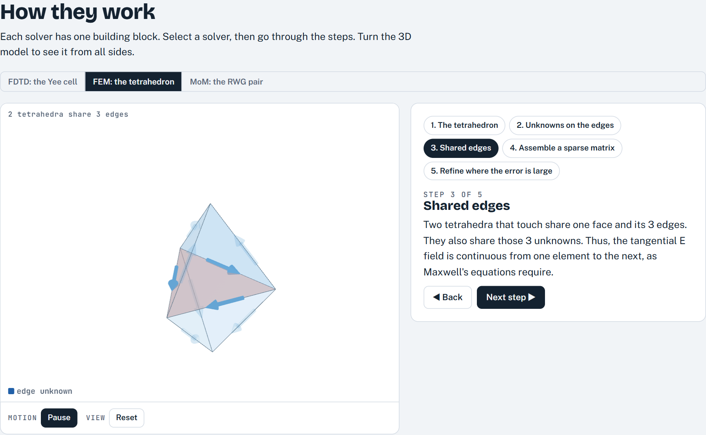 | 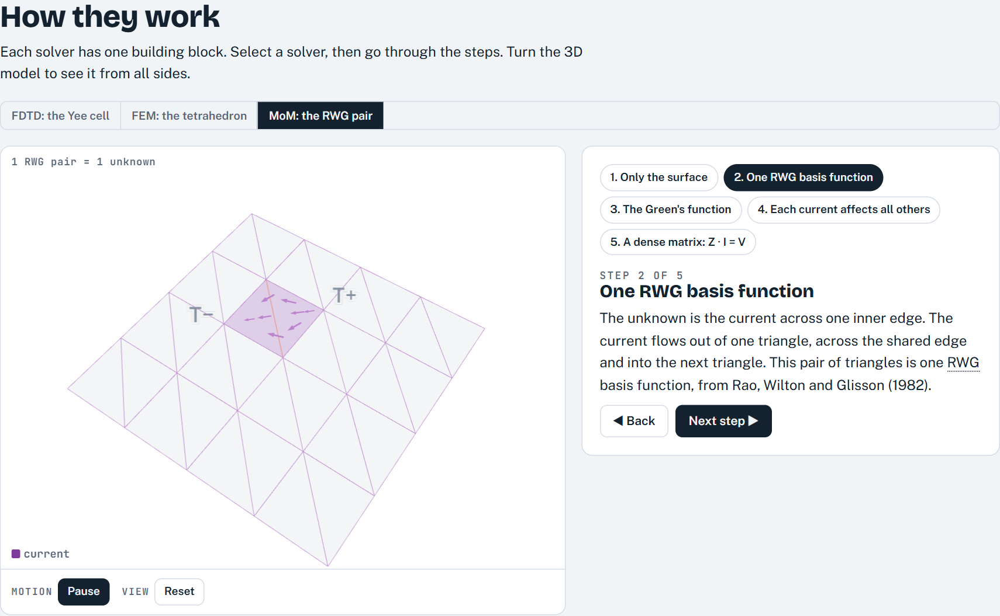 |

### Convergence
Three cards ask the same question for each solver: when is it done? Each card gives a one-line rule and opens its demos.
- **FEM:** adaptive passes with ΔS against a target.
- **FDTD, time:** a resonance rings down. Set Q and the stop threshold, and see the truncated spectrum get ripple and a low peak when the run stops too early. The decay takes about 0.037 · X · Q periods for X dB.
- **FDTD, stability:** a live 1D FDTD run. Push the Courant number above 1 and the field becomes unstable. This rule is stability, not accuracy.
- **FDTD, space:** numerical dispersion against cells per wavelength (about 1.1 % at 10 cells/λ, 0.28 % at 20).
- **MoM, mesh:** a real thin-wire MoM solve of a half-wave dipole in the browser. Change the segments, the wire radius, the feed (fixed gap or delta gap) and the kernel (exact or thin-wire). It plots Zin against segments per λ, ΔZ from N/2 and the current on the wire, and shows three traps: the delta gap never settles, the thin-wire kernel breaks down when a segment is shorter than about 2 radii, and 73 + j42.5 Ω is only the infinitely thin limit. The solver agrees with the Python reference solvers to less than 0.001 Ω.
- **MoM, edges:** the capacitance of a square plate with a uniform and an edge-graded mesh (computed), with the charge crowding at the edges.
- **MoM, cost:** halve the edge length and the unknowns grow 4 times, the memory 16 times and the direct-solve time 64 times. The browser time is measured on your device.

| When is each solver done? | MoM dipole lab |
|---|---|
| 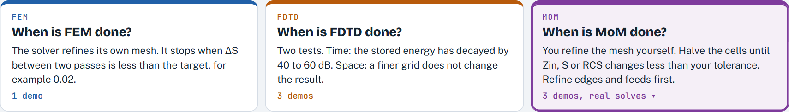 | 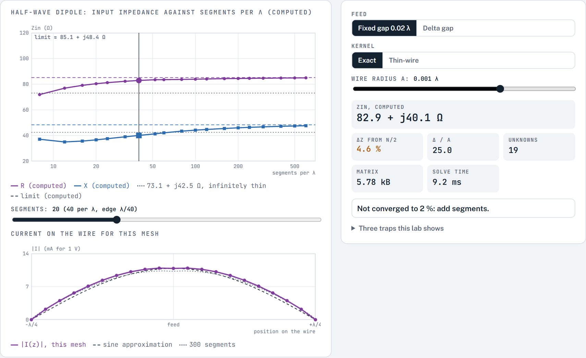 |

| FDTD ring-down | Courant limit | FEM adaptive mesh and ΔS |
|---|---|---|
| 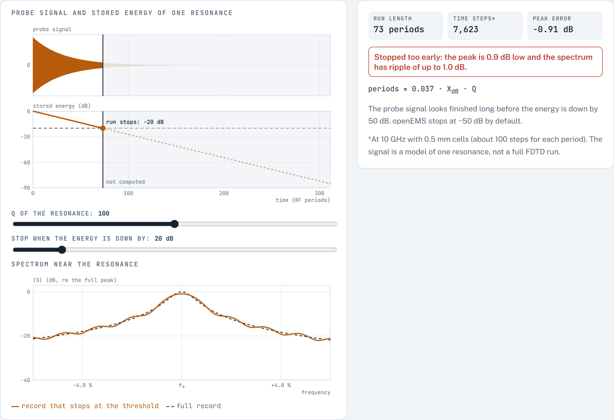 | 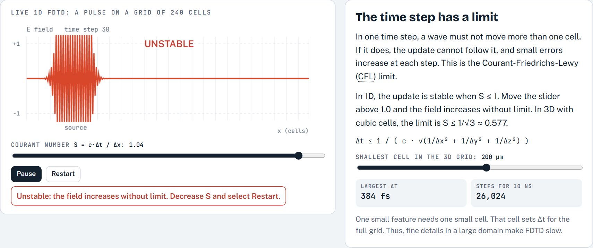 | 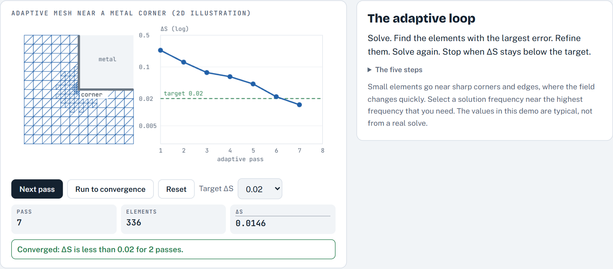 |

### Compare, then select
A short comparison of FDTD, FEM, 3D MoM and 2.5D MoM. Then the picker:
- Drag a point on a size × frequency pad. The pad is coloured by the method that wins at each point for your other choices, and it shows the size in wavelengths.
- Press chips for the structure, the result, the band, the field, the licence, the design flow and the cloud.
- The method ranking re-orders live. The winner shows with one reason; the other reasons are one click away.
- The three tools to look at first show as cards with method, licence and badges. A rough problem size for each method opens below.

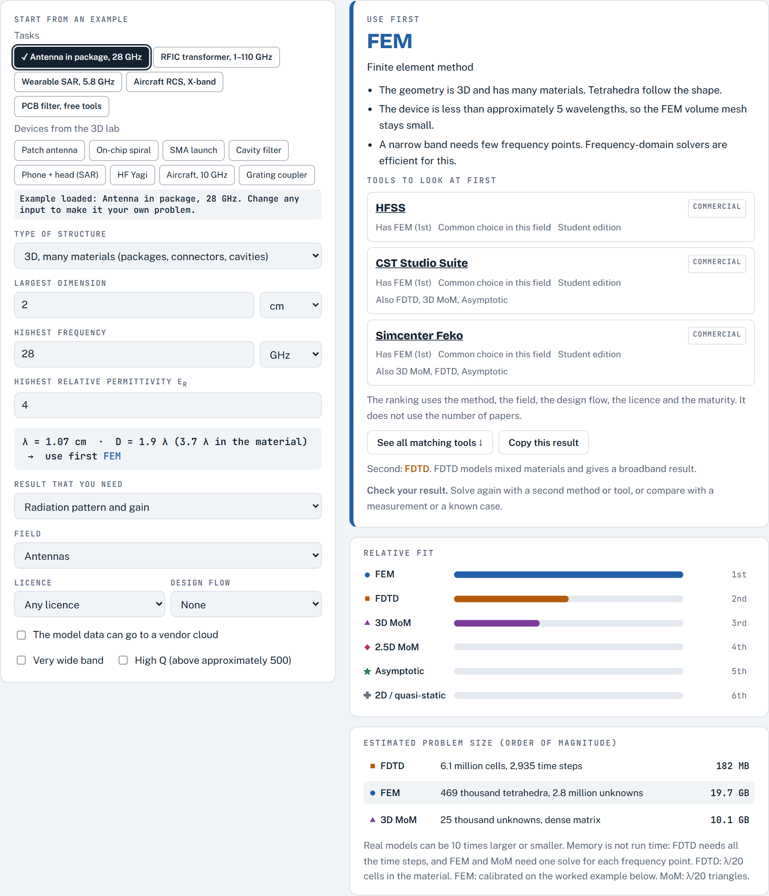

### Tools and research use
Data for 62 commercial, open-source and free tools: methods, owner, price tier, student or trial editions, scripting, GPU, HPC, import formats and design-flow links. It also has free paths that work, typical tool sets for a small team, and the number of papers that mention each tool.

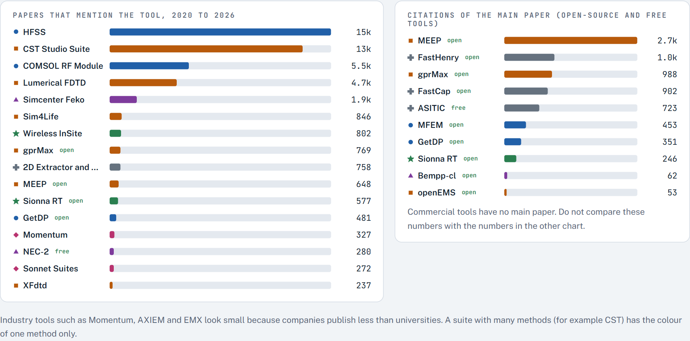

## Data and how to rebuild it

| File | Content | Source |
|---|---|---|
| [`data/tools-meta.json`](data/tools-meta.json) | One record for each tool, with source URLs | Vendor pages and documentation, checked 14 October 2026, 6 tools added 17 October 2026 ([notes](data/tools-meta.md)) |
| [`meshes/`](meshes) | The Gmsh mesh of each device: surfaces, a slice of the tetrahedra, MoM triangles and counts | [`scripts/meshgen.py`](scripts/meshgen.py) (Gmsh 4.15, OpenCASCADE geometry) |
| [`data/citations.json`](data/citations.json) | Paper mentions for each tool since 2020, and main-paper citations for open-source tools | OpenAlex API, 14 October 2026, new tools 17 October 2026 ([method](data/citations-method.md)) |

The page contains a copy of this data. After you change a data file, run:

```bash
node scripts/build-tools.js
node scripts/embed-citations.js
```

To make the meshes again (needs Python with `gmsh` and `numpy`), then put them in the page:

```bash
python scripts/meshgen.py
node scripts/embed-meshes.js
```

## Limits

- The solver scores are rules of thumb. Use them as a first step, then check the result with a second method.
- The meshes are real Gmsh meshes with typical element sizes. A converged solver mesh is finer. Some very thin parts (wires, struts) are a little thicker than in a real device, so that the mesher can resolve them.
- The FEM convergence demo and the size estimates use typical values. The FDTD ring-down uses a model of one resonance. The 1D FDTD run, the dispersion values and the MoM dipole and plate demos are real calculations in the browser. The MoM numbers come from small teaching solvers (checked against Python reference solvers and AN-SOF), not from a commercial tool.
- Paper counts show research use, not industry use. Companies publish less than universities.
- Prices are tiers only, because vendors do not publish prices. Product names are the property of their owners.

## Licence

MIT. See [LICENSE](LICENSE).
