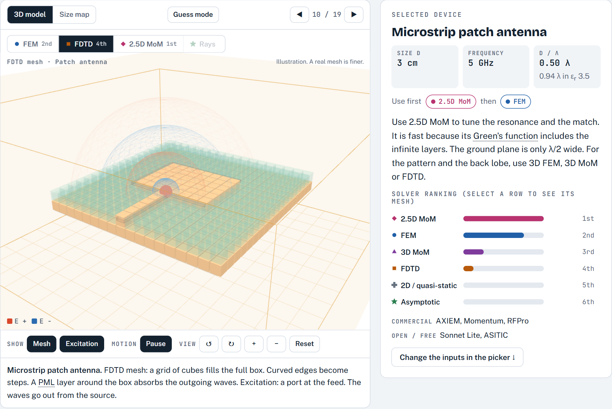
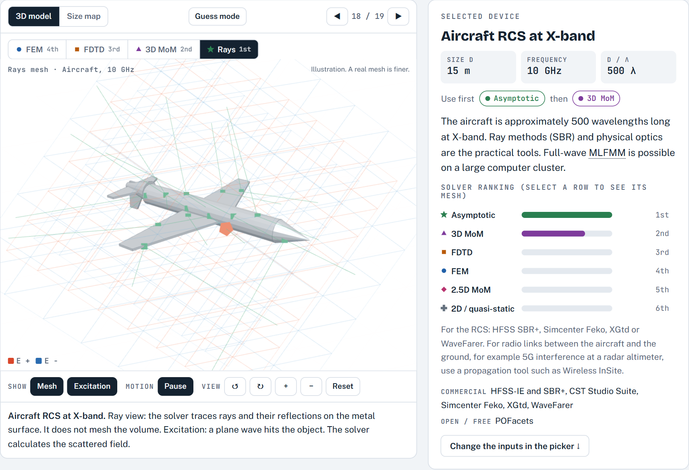
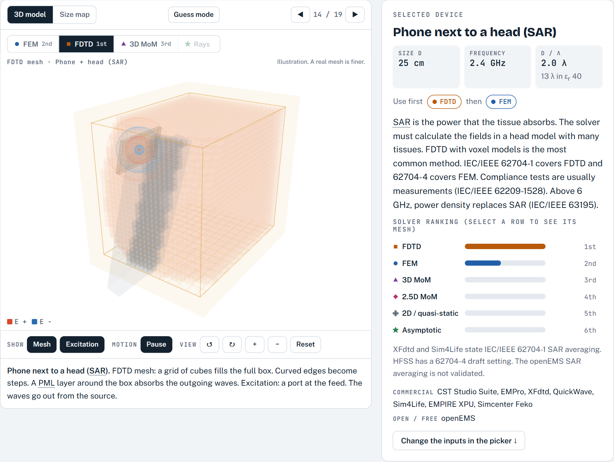

# FDTD, FEM or MoM?

An interactive guide to electromagnetic (EM) solvers. Learn how the three main full-wave methods work, see their meshes on real devices in 3D, and select a solver and a tool for your problem.

The full guide is one HTML file, [`index.html`](index.html). Open it in a browser. It needs no build step and no server.


## What is in the guide

### Devices in 3D
Select one of 19 devices, from an on-chip spiral to a ship. The 3D view shows the model, the mesh that each solver makes and an animation of the excitation. The card shows which solver to use first, and why. A guess mode lets you test yourself before the answer shows.

| FDTD mesh of a patch antenna | Rays on an aircraft at X-band | FDTD for SAR in a head |
|---|---|---|
|  |  |  |

### How each solver works
Step-by-step 3D lessons, each with a short quiz:
- **FDTD:** the Yee cell, with E on the edges, H on the faces and leapfrog time steps.
- **FEM:** the tetrahedron, with one unknown on each edge, the sparse matrix and adaptive refinement.
- **MoM:** the RWG basis function, the Green's function and the dense matrix.

| Yee cell | Tetrahedra | RWG pair |
|---|---|---|
|  |  |  |

### Convergence
- A live 1D FDTD simulation. Push the Courant number above 1 and the field becomes unstable.
- FEM adaptive passes with ΔS against a target.
- MoM mesh density against the memory of the dense matrix.

| Courant limit | Adaptive mesh and ΔS |
|---|---|
|  |  |

### Compare, then select
A short comparison of FDTD, FEM, 3D MoM and 2.5D MoM. A picker takes the size, frequency, permittivity, result, field, licence and design flow. It gives the method to use first, the three tools to look at first and a rough problem size.


### Tools and research use
Data for 56 commercial, open-source and free tools: methods, owner, price tier, student or trial editions, scripting, GPU, HPC, import formats and design-flow links. It also has free paths that work, typical tool sets for a small team, and the number of papers that mention each tool.


## Data and how to rebuild it

| File | Content | Source |
|---|---|---|
| [`data/tools-meta.json`](data/tools-meta.json) | One record for each tool, with source URLs | Vendor pages and documentation, checked 14 October 2026 ([notes](data/tools-meta.md)) |
| [`data/citations.json`](data/citations.json) | Paper mentions for each tool since 2020, and main-paper citations for open-source tools | OpenAlex API, 14 October 2026 ([method](data/citations-method.md)) |

The page contains a copy of this data. After you change a data file, run:

```bash
node scripts/build-tools.js
node scripts/embed-citations.js
```

## Limits

- The solver scores are rules of thumb. Use them as a first step, then check the result with a second method.
- The 3D meshes, the FEM and MoM convergence demos, and the size estimates are illustrations with typical values. The 1D FDTD demo is a real simulation.
- Paper counts show research use, not industry use. Companies publish less than universities.
- Prices are tiers only, because vendors do not publish prices. Product names are the property of their owners.

## Licence

MIT. See [LICENSE](LICENSE).
